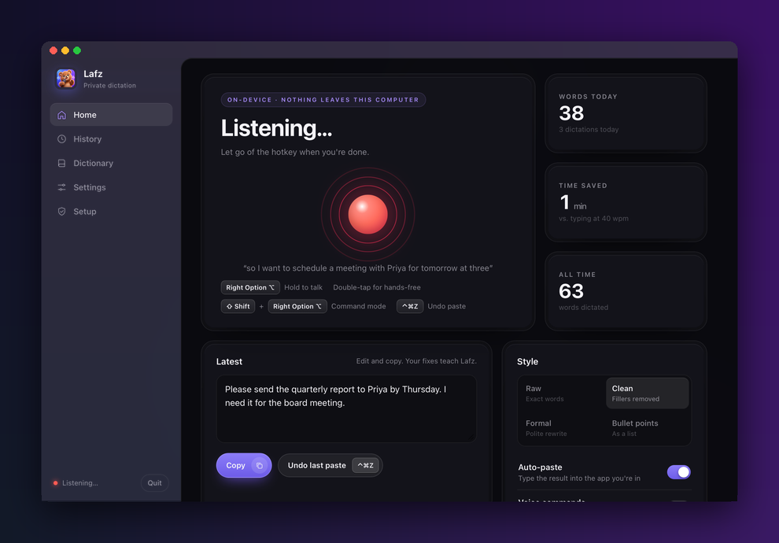

<p align="center">
  
</p>

<h1 align="center">Lafz</h1>

<p align="center">
  Private, free push-to-talk dictation for your desktop.<br>
  Hold a key, speak, let go. Clean text appears wherever your cursor is.<br>
  Everything runs on your own computer. No account, no cloud, no subscription.
</p>

<p align="center"><i>Lafz (لفظ) means "word" in Urdu. It was called Murmur until version 0.5.0.</i></p>

<p align="center">
  <a href="https://github.com/Zulgo/lafz/actions/workflows/ci.yml"></a>
  <a href="LICENSE"></a>
</p>

<p align="center"></p>

---

## Why Lafz?

Cloud dictation tools send your voice to someone else's servers. Lafz runs entirely on your machine:

- **Speech recognition** with OpenAI Whisper (open source, on-device)
- **Speech detection** with Silero VAD, so silence, clicks, breathing and fan noise don't become fake text
- **Optional AI cleanup** with a small local language model through [Ollama](https://ollama.com): removes "um", "uh" and stutters and fixes punctuation, without rewording what you said

After the one-time model downloads, Lafz works fully offline.

## Features

- **Push-to-talk:** hold the hotkey, speak, release. The text is pasted into the app you were typing in.
- **Hands-free:** double-tap the hotkey to keep recording; tap again to finish.
- **Command mode:** select text, hold **Shift** + the hotkey and say what to do ("make this shorter", "translate to German"). With nothing selected, say what to write ("a polite reply declining the meeting").
- **Voice commands:** say "new line", "new paragraph" or "bullet point" for formatting.
- **Self-corrections:** "at 3, no wait, 4 pm" becomes "at 4 pm".
- **Your clipboard is kept:** whatever you had copied is put back after Lafz pastes.
- **Live preview:** see your words while you're still speaking.
- **Writing styles:** Raw, Clean (fillers removed), Formal (polite rewrite), Bullet points, plus **per-app styles** (raw in the terminal, formal in Mail).
- **16 languages** or auto-detect, including English, Spanish, French, German, Hindi, Urdu, Arabic, Chinese and Japanese.
- **Learns from you, locally:** correct the same word twice and Lafz fixes it automatically from then on; names you use often become spelling hints.
- **Personal dictionary**, **searchable history**, **undo last paste**, and **model comparison** on your own recordings.
- **Memory saver** for 8 GB machines: the speech model rests after 10 idle minutes and wakes when you speak.
- **Native feel on macOS:** frosted-glass window and recording indicator, a menu bar bear, and an optional menu-bar-only mode.

## Requirements

| | macOS | Windows |
| --- | --- | --- |
| Status | Tested | **Experimental**: automated tests pass; not yet tried on real hardware by the author |
| System | **Apple Silicon (M1 or newer)**, recent macOS (tested on macOS 26) | Windows 10 or 11 |
| Memory | 8 GB minimum, 16 GB recommended | 8 GB minimum |
| Disk | About 3 GB for the models | About 3 GB for the models |
| Tools | Apple Command Line Tools (the installer asks for them) | `winget` and Microsoft Edge (both built into Windows 10/11) |

Intel Macs should work with the CPU speech engine, but this is untested and will be noticeably slower.

## Install

### macOS

1. **Download Lafz.** Choose a folder that is *not* inside Desktop, Documents or iCloud Drive, for example your home folder:
   ```bash
   cd ~
   git clone https://github.com/Zulgo/lafz.git
   cd lafz
   ```
   No git? Download the **Source code (zip)** from the [latest release](https://github.com/Zulgo/lafz/releases/latest), unzip it into your home folder, and open Terminal in that folder.

2. **Run the installer:**
   ```bash
   ./install_mac.command
   ```
   It installs [uv](https://docs.astral.sh/uv/) (a Python manager) and [Ollama](https://ollama.com) if they're missing, downloads the cleanup model, installs Lafz's libraries and creates **Lafz.app** in `~/Applications`. Then it opens Lafz.

3. **Finish the Setup page.** Lafz opens on **Setup**. Click each button until every required line is ✅:
   - **Microphone:** to hear you
   - **Accessibility:** to paste text, undo and learn from your corrections
   - **Input Monitoring** is only needed if the hotkey doesn't respond; Lafz detects this for you.

   Then click **Restart Lafz**. The first launch downloads the speech model (about 1.6 GB), so give it a few minutes.

From now on, open Lafz from Spotlight (⌘ Space → "Lafz"), Launchpad or the menu bar bear.

### Windows (experimental)

1. Download the **Source code (zip)** from the [latest release](https://github.com/Zulgo/lafz/releases/latest) and unzip it, for example into `C:\Users\<you>\lafz`.
2. Double-click **`install_windows.bat`**. If Windows shows "Windows protected your PC", click **More info**, then **Run anyway**.
   It installs uv and Ollama, downloads the cleanup model and puts a **Lafz** shortcut on your Desktop.
3. Open **Lafz** from the Desktop. Its window opens as an app window in Microsoft Edge. Hold **Right Ctrl** to dictate.
   The first dictation downloads the speech model (about 1.6 GB), so give it a few minutes.

If something fails on Windows, please [open an issue](https://github.com/Zulgo/lafz/issues/new/choose) with the error. It helps a lot.

### Manual install (developers)

```bash
git clone https://github.com/Zulgo/lafz.git && cd lafz
uv sync                      # install dependencies into .venv
ollama pull qwen2.5:1.5b     # optional: AI cleanup model
uv run python app.py         # run from the terminal
uv run pytest                # run the tests
```

On macOS, `./build_app.sh` creates the clickable `~/Applications/Lafz.app`.

### Updating

- **Mac:** in Lafz's folder, run `git pull` (or unzip the new release over it), then `./install_mac.command`. If the app
  changed, macOS asks you to allow Microphone and Accessibility again once.
- **Windows:** unzip the new release over the old folder and run `install_windows.bat` again.

Your history, dictionary and learned words are kept.

**Coming from Murmur?** Update as above. The Mac installer replaces Murmur.app with Lafz.app (the old app goes to the
Trash), and Lafz moves your history and settings over on its first launch. Allow Microphone and Accessibility for
Lafz once.

## How to use

| Action | macOS | Windows |
| --- | --- | --- |
| Dictate | Hold **Right Option ⌥**, speak, release | Hold **Right Ctrl**, speak, release |
| Hands-free | Double-tap the hotkey, tap again to finish | Same |
| Command mode | Hold **Shift** + the hotkey | Same (writes new text; editing a selection is Mac-only) |
| Undo the last paste | **⌃⌘Z** | **Ctrl+Alt+Z** |

1. Click into any text field: email, chat, document, browser.
2. Hold the hotkey and speak naturally. A small indicator shows that Lafz is listening.
3. Release. Lafz transcribes, cleans up, and pastes the text. It's saved in History too.

You can change the hotkey in **Settings** (Right Option, Right Command or Right Control on Mac).

### Styles

| Style | What it does | Needs Ollama |
| --- | --- | --- |
| Raw | Exactly what the speech model heard | No |
| Clean (default) | Removes um/uh and stutters, fixes punctuation, **keeps your words** | Optional (basic rules without it) |
| Formal | Rewrites into a polite, professional tone | Yes |
| Bullet points | Turns your thoughts into a list | Yes |

**Per-app styles** (Settings), one rule per line:

```
Terminal = raw
Mail = formal
Slack = clean
```

### Voice commands

| Say | You get |
| --- | --- |
| "new line" | a line break |
| "new paragraph" | an empty line |
| "bullet point" / "next bullet" | a new `- ` list item |

Turn them off in Settings if you dictate those words literally.

### Self-corrections

Changed your mind mid-sentence? Lafz keeps only what you meant:

| You say | You get |
| --- | --- |
| "Let's meet at 3, no wait, 4 pm" | Let's meet at 4 pm. |
| "Send it to John, sorry, to Priya" | Send it to Priya. |
| "Book the room for Tuesday. Scratch that, let's do it next week" | Let's do it next week. |

The local AI may only **remove** the words you took back; if it adds or rewords anything, Lafz ignores it. Words like
"actually" or "sorry" that you mean literally are kept. Without Ollama, built-in rules handle "scratch that" and clear
cases like "on Tuesday, I mean on Wednesday". Not applied in the Raw style; turn it off in Settings.

### Dictionary

Add names and terms Lafz should spell correctly, one per line. For a word that keeps coming out wrong, add a fix:

```
Priya
Kubernetes
dust in -> Dustin
```

### Learning from your corrections

Lafz gets better the more you use it, without sending anything anywhere:

- **Corrections:** after a dictation is pasted, Lafz briefly checks the same text field again (for up to 90 seconds, or until your next dictation). If you changed a word, for example `dust in` to `Dustin`, it notes the pair. When you make **the same correction twice**, it becomes an automatic fix. One-off rewrites (changing "Friday" to "Monday") aren't learned, because they're not recognition mistakes.
- **Vocabulary:** names and unusual words in text you've kept or corrected (`Priya`, `iOS`, `GPT4`) are given to Whisper as spelling hints.
- **Edits in Lafz's window** count too: fix the text in the *Latest* card and press Copy.

See and remove anything it learned on the **Dictionary** page. Turn learning off in **Settings**. Lafz doesn't retrain the speech model; learning works through fixes and hints, which is fast, private and instantly undoable.

### Choosing a speech model

| Model | Speed (M1, one sentence) | Best for |
| --- | --- | --- |
| Whisper Accurate (large-v3-turbo) | ~1.5 s | Names, technical words and other languages |
| Whisper Fast (small) | ~0.5 s | Older or busy machines |

Not sure? Dictate a few normal sentences, then use **Settings → Compare**. It runs both models on your own voice and lets you switch with one click.

## Privacy

- Audio, text and history never leave your computer. Lafz sends nothing over the internet except the **one-time model downloads** (from Hugging Face and Ollama).
- The AI cleanup and command mode talk only to Ollama running on your own machine (`localhost`).
- Lafz's window is a small web page served **only to this computer** (127.0.0.1), protected by a secret token created at every launch. It can't be reached from the network or from websites.
- History and settings are stored in `~/Library/Application Support/Lafz` (Mac) or `%APPDATA%\Lafz` (Windows).
- Lafz keeps your **last 10 recordings** locally so you can compare models. Turn this off in Settings; that also deletes them.
- **Learning** reads only the few words around the text Lafz itself just pasted, never anything else in the field, and never password fields. It stores only word pairs and counts (`learning.json`). Turn it off in Settings.
- There is no telemetry, analytics or account.

## Troubleshooting

<details>
<summary><b>Nothing happens when I hold the hotkey (Mac)</b></summary>

Open the **Setup** page. Accessibility must be ✅; if the hotkey still doesn't respond, grant Input Monitoring too. If you rebuilt the app, macOS may show an old "Lafz" entry: remove it with **−** in System Settings → Privacy & Security, add `~/Applications/Lafz.app` again with **+**, then click **Restart Lafz**.
</details>

<details>
<summary><b>"Lafz would like to access files in your Desktop folder"</b></summary>

Lafz runs from the folder you installed it in. If that's on your Desktop or in Documents, macOS asks for access. Click **Allow**, or move the folder to your home directory and run `./install_mac.command` again.
</details>

<details>
<summary><b>Text isn't pasted</b></summary>

Pasting needs Accessibility permission. Your text is also in the *Latest* card and in History, ready to copy. If you turned off **Keep my clipboard**, it's on your clipboard as well.
</details>

<details>
<summary><b>Cleanup or command mode says Ollama isn't running</b></summary>

Start Ollama (`brew services start ollama` on Mac, or open the Ollama app), or click **Start** on the Setup page. Without Ollama, Lafz still removes filler words with built-in rules; command mode needs it.
</details>

<details>
<summary><b>It's slow</b></summary>

On 8 GB Macs, try **Whisper Fast** (Settings → Speech model) and keep **Memory saver** on. After a rest, the first dictation takes a few extra seconds while the model wakes up.
</details>

<details>
<summary><b>Lafz doesn't open after updating Python or uv (Mac)</b></summary>

Lafz.app runs the Python that was installed when the app was built. If that Python was updated or removed, rebuild
the app: open Terminal in the Lafz folder and run `uv sync && ./build_app.sh`.
</details>

<details>
<summary><b>Where are the logs?</b></summary>

Mac: `~/Library/Logs/Lafz.log`. Windows: `lafz.log` in your user folder.
</details>

## How it works

```
 hotkey ──► microphone ──► Silero VAD ──► Whisper ──► dictionary ──► voice commands ──► cleanup ──► paste
 (hold)     (any rate,     (keeps only    (on-device  (your fixes)   (new line,         (rules +    (clipboard
             resampled)     real speech)   speech to                  bullets)           local LLM)  restored)
                                           text)
```

The local LLM's cleanup is only accepted when it stays very close to what you said. If it rewords things, Lafz keeps your words and tells you.

## Project structure

| File | Purpose |
| --- | --- |
| `app.py` | Main app: hotkey state machine, recording, processing queue, state for the window |
| `engine.py` | Speech detection, speech-to-text, dictionary, voice commands, cleanup, command mode |
| `learning.py` | Local adaptive learning from corrections and vocabulary |
| `system.py` | OS integration: focus, keystrokes, clipboard, sounds, permissions, login item, storage |
| `webui.py` | Local-only server for the window (token-protected, 127.0.0.1) |
| `ui/` | The window: `index.html`, `app.css`, `app.js` |
| `macwindow.py` | macOS frosted-glass window hosting the interface |
| `pill.py`, `menubar.py` | macOS recording indicator and menu bar icon |
| `build_app.sh` | Builds `~/Applications/Lafz.app` (a small native launcher) |
| `install_mac.command`, `install_windows.bat` | One-step installers |
| `make_icon.py` | Generates the app and menu bar icons from `assets/logo_source.png` |
| `tests/` | Automated tests (run on macOS and Windows for every change) |

## Contributing

Contributions are very welcome, especially **testing on Windows**, Intel Macs and non-US keyboard layouts. See [CONTRIBUTING.md](CONTRIBUTING.md).

## License

Lafz is released under the [MIT License](LICENSE). The speech and language models it downloads have their own licenses; see [THIRD_PARTY_NOTICES.md](THIRD_PARTY_NOTICES.md).
