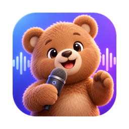

<p align="center">
  
</p>

<h1 align="center">Murmur</h1>

<p align="center">
  Private, free push-to-talk dictation for your desktop.<br>
  Hold a key, speak, let go. Clean text appears wherever your cursor is.<br>
  Everything runs on your own computer. No account, no cloud, no subscription.
</p>

---

## Why Murmur?

Cloud dictation tools send your voice to someone else's servers. Murmur runs entirely on your machine:

- **Speech recognition** with OpenAI Whisper or NVIDIA Parakeet (open models, running locally)
- **Speech detection** with Silero VAD, so silence, clicks, breathing and fan noise don't become fake text
- **Optional AI cleanup** with a small local language model through [Ollama](https://ollama.com): removes "um", "uh" and stutters and fixes punctuation, without rewording what you said

After the one-time model downloads, Murmur works fully offline.

## Features

- **Push-to-talk:** hold the hotkey, speak, release. The text is pasted into the app you were typing in.
- **Hands-free:** double-tap the hotkey to keep recording; tap again to finish.
- **Live preview:** see your words while you're still speaking.
- **Writing styles:** Raw (exact words), Clean (fillers removed), Formal (polite rewrite), Bullet points.
- **Per-app styles:** for example, raw text in your terminal and formal text in Mail.
- **Personal dictionary:** teach it names and jargon, and fix words it keeps getting wrong (`dust in -> Dustin`).
- **Searchable history:** every dictation, with time and app, one click to copy.
- **Undo:** one shortcut removes the last paste.
- **Model comparison:** run every speech model on your own recent recordings and pick the most accurate one for your voice.
- **Native feel on macOS:** a frosted-glass recording indicator, a menu bar icon and a Setup checklist for permissions.

## Requirements

| | macOS | Windows |
| --- | --- | --- |
| Status | Tested | **Experimental** (written for, not yet tested on real hardware) |
| System | **Apple Silicon (M1 or newer)**, recent macOS (tested on macOS 26) | Windows 10 or 11 |
| Memory | 8 GB minimum, 16 GB recommended | 8 GB minimum |
| Disk | About 4 GB for the models | About 4 GB for the models |
| Tools | Apple Command Line Tools (the installer asks for them) | `winget` (built into Windows 10/11) |

Intel Macs should work with the CPU speech engine, but this is untested and will be noticeably slower.

## Install

### macOS

1. **Download Murmur.** Choose a folder that is *not* inside Desktop, Documents or iCloud Drive, for example your home folder:
   ```bash
   cd ~
   git clone https://github.com/Zulgo/murmur.git
   cd murmur
   ```
   (No git? Click **Code → Download ZIP** on GitHub, unzip it into your home folder, and open Terminal in that folder.)

2. **Run the installer:**
   ```bash
   ./install_mac.command
   ```
   It installs [uv](https://docs.astral.sh/uv/) (a Python manager) and [Ollama](https://ollama.com) if they're missing, downloads the cleanup model, installs Murmur's libraries and creates **Murmur.app** in `~/Applications`. Then it opens Murmur.

3. **Grant permissions.** Murmur opens on its **Setup** tab. Click each button until every line is ✅:
   - **Microphone:** to hear you
   - **Accessibility:** to paste text and read the hotkey
   - **Input Monitoring:** for the hotkey

   Then click **Restart Murmur**. The first launch downloads the speech model (about 1.6 GB), so give it a few minutes.

From now on, open Murmur from Spotlight (⌘ Space → "Murmur") or Launchpad.

### Windows (experimental)

1. Download the repository (**Code → Download ZIP**) and unzip it, for example into `C:\Users\<you>\murmur`.
2. Double-click **`install_windows.bat`**. It installs uv and Ollama, downloads the models and puts a **Murmur** shortcut on your Desktop.
3. Open **Murmur** from the Desktop.

If something fails on Windows, please [open an issue](https://github.com/Zulgo/murmur/issues) with the error. It helps a lot.

### Manual install (any platform, for developers)

```bash
git clone https://github.com/Zulgo/murmur.git && cd murmur
uv sync                      # install dependencies into .venv
ollama pull qwen2.5:3b       # optional: AI cleanup model
uv run python app.py         # run from the terminal
```

On macOS, `./build_app.sh` creates the clickable `~/Applications/Murmur.app`.

## How to use

| Action | macOS | Windows |
| --- | --- | --- |
| Dictate | Hold **Right Option ⌥**, speak, release | Hold **Right Ctrl**, speak, release |
| Hands-free | Double-tap the hotkey, tap again to finish | Same |
| Undo the last paste | **⌃⌘Z** | **Ctrl+Alt+Z** |

1. Click into any text field: email, chat, document, browser.
2. Hold the hotkey and speak naturally. A small indicator shows that Murmur is listening.
3. Release. Murmur transcribes, cleans up, and pastes the text. It's also copied to your clipboard and saved in History.

You can change the hotkey in **Settings** (Right Option, Right Command or Right Control on Mac).

### Styles

| Style | What it does | Needs Ollama |
| --- | --- | --- |
| Raw | Exactly what the speech model heard | No |
| Clean (default) | Removes um/uh and stutters, fixes punctuation, **keeps your words** | Optional (basic rules without it) |
| Formal | Rewrites into a polite, professional tone | Yes |
| Bullet points | Turns your thoughts into a list | Yes |

**Per-app styles** (Settings): one rule per line, `App name = style`, e.g.

```
Terminal = raw
Mail = formal
Slack = clean
```

### Dictionary

Add names and terms Murmur should spell correctly, one per line. For a word that keeps coming out wrong, add a fix:

```
Priya
Kubernetes
dust in -> Dustin
```

Whisper uses both the word list and the fixes. Parakeet uses only the fixes.

### Choosing a speech model

| Model | Speed (M1) | Best for |
| --- | --- | --- |
| Whisper Accurate (large-v3-turbo) | ~1.5 s per sentence | Names and technical words (works with the Dictionary) |
| Whisper Fast (small.en) | ~0.5 s | Older or busy machines |
| Parakeet (NVIDIA, English) | ~0.4 s | Speed; hears filler words faithfully |

Not sure? Dictate a few normal sentences, then use **Settings → Compare models on my recent recordings**. It runs every model on your own voice and lets you switch with one click.

## Privacy

- Audio, text and history never leave your computer. Murmur sends nothing over the internet except the **one-time model downloads** (from Hugging Face and Ollama).
- The AI cleanup talks only to Ollama running on your own machine (`localhost`).
- History and settings are stored in `~/Library/Application Support/Murmur` (Mac) or `%APPDATA%\Murmur` (Windows).
- Murmur keeps your **last 10 recordings** locally so you can compare models. Turn this off in Settings; that also deletes them.
- There is no telemetry, analytics or account.

## Troubleshooting

<details>
<summary><b>Nothing happens when I hold the hotkey (Mac)</b></summary>

Open the **Setup** tab. Accessibility and Input Monitoring must be ✅. If you rebuilt the app, macOS may still show an old "Murmur" entry: remove it with **−** in System Settings → Privacy & Security, add `~/Applications/Murmur.app` again with **+**, then click **Restart Murmur**.
</details>

<details>
<summary><b>"Murmur would like to access files in your Desktop folder"</b></summary>

Murmur runs from the folder you installed it in. If that's on your Desktop or in Documents, macOS asks for access. Click **Allow**, or move the folder to your home directory and run `./install_mac.command` again.
</details>

<details>
<summary><b>Text is pasted in the wrong place or not at all</b></summary>

Accessibility permission is needed for pasting. The text is always on your clipboard too, so you can paste it with ⌘V / Ctrl+V. You can also turn off **Auto-paste** and copy from the window.
</details>

<details>
<summary><b>Cleanup says "Ollama isn't running"</b></summary>

Start Ollama (`brew services start ollama` on Mac, or open the Ollama app), or click **Start** in the Setup tab. Without Ollama, Murmur still removes filler words with built-in rules.
</details>

<details>
<summary><b>It's slow</b></summary>

On 8 GB Macs, try the **Parakeet** model and close memory-heavy apps. The first dictation after launch is slower while models load.
</details>

<details>
<summary><b>Where are the logs?</b></summary>

Mac: `~/Library/Logs/Murmur.log`. Windows: `murmur.log` in your user folder.
</details>

## How it works

```
 hotkey ──► microphone ──► Silero VAD ──► Whisper / Parakeet ──► dictionary fixes ──► cleanup ──► paste
 (hold)     (any rate,      (keeps only     (speech-to-text,       (your word list)      (rules +     (into the
             resampled)      real speech)    on-device)                                   local LLM)    app you
                                                                                                        were in)
```

The local LLM's output is only accepted when it stays very close to what you said. If it rewords things, Murmur keeps your words and tells you.

## Project structure

| File | Purpose |
| --- | --- |
| `app.py` | Main app: window, hotkey state machine, recording, processing queue |
| `engine.py` | Speech detection, speech-to-text models, dictionary, cleanup |
| `system.py` | OS integration: focus, keystrokes, sounds, permissions, login item, storage |
| `pill.py` | macOS frosted-glass recording indicator |
| `menubar.py` | macOS menu bar icon and menu |
| `build_app.sh` | Builds `~/Applications/Murmur.app` (a small native launcher) |
| `install_mac.command`, `install_windows.bat` | One-step installers |
| `make_icon.py` | Generates the app and menu bar icons from `assets/logo_source.png` |
| `assets/` | Icons and the Silero VAD model |

## Contributing

Contributions are very welcome, especially **testing on Windows**, Intel Macs and non-US keyboard layouts. See [CONTRIBUTING.md](CONTRIBUTING.md).

## License

Murmur is released under the [MIT License](LICENSE). The speech and language models it downloads have their own licenses; see [THIRD_PARTY_NOTICES.md](THIRD_PARTY_NOTICES.md).
